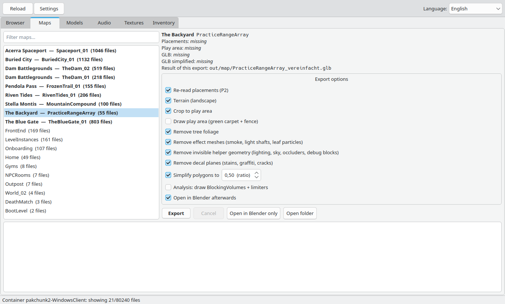
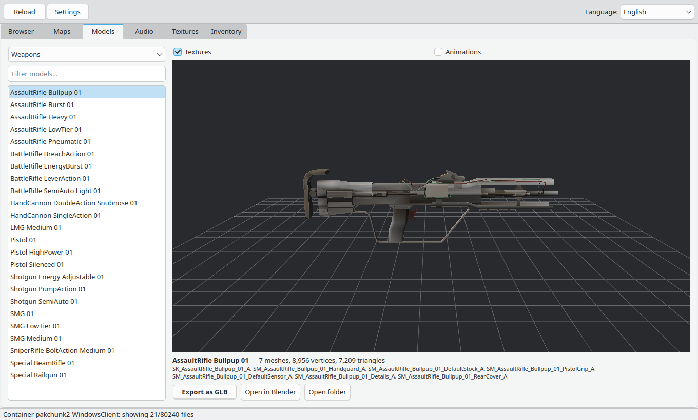
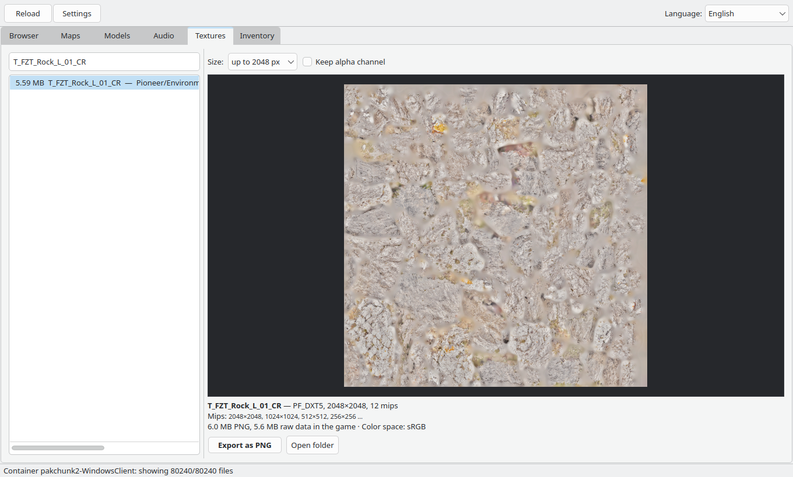
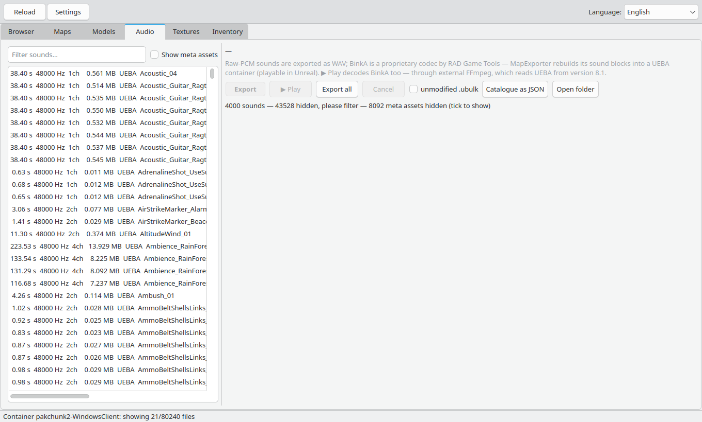
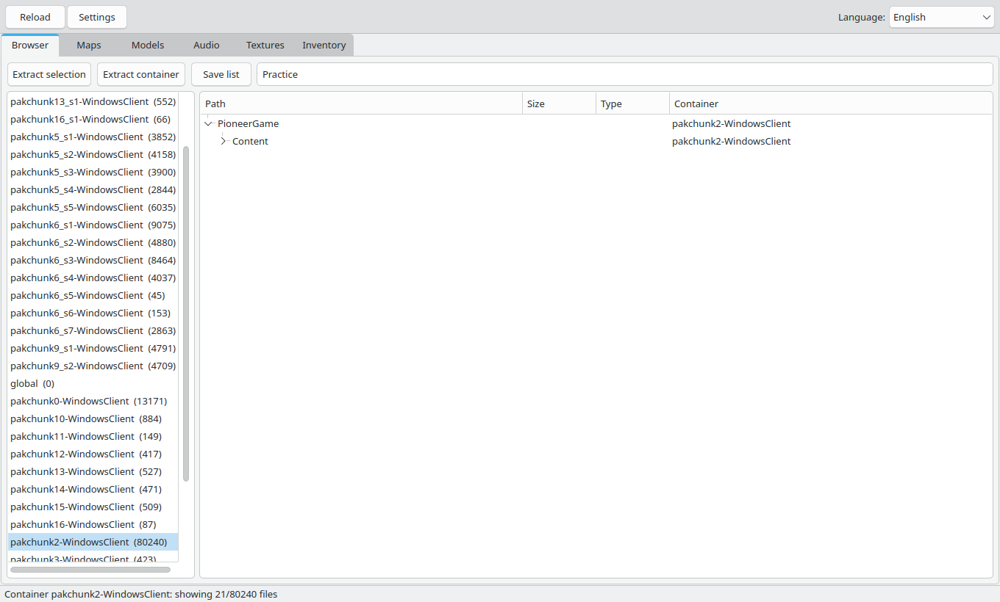

# MapExporter — ARC Raiders maps → GLB

Reads ARC Raiders' game files offline (IoStore/Zen, pure Python) and builds GLBs from them:
whole maps (buildings, props, vegetation, terrain) as well as individual models — weapons, ARC bots,
equipment and complete character outfits. The GUI also browses the game's audio and texture
assets, exports WAV, UEBA containers and PNG, and in the file browser a double-click gives
preview, playback or export for every file. Runs on Windows and Linux.

## Screenshots

| Maps tab — map list and export options | Models tab — weapon with textured 3D preview |
|---|---|
|  |  |

| Textures tab — preview and PNG export | Audio tab — sound catalogue with durations |
|---|---|
|  |  |

## Getting started

- **Windows:** double-click `start.bat`. On the first start it installs the Python packages from
  `requirements.txt` automatically.
- **Linux:** `./start.sh`

In the GUI: tab **Maps** → pick a map → export options → **Export**. Progress and total time appear
under the buttons; the result lands in `out/map/`.

## Requirements

- Python 3.10+ with `pip install -r requirements.txt` (pycryptodome, numpy, PyQt6)
- ARC Raiders installed via Steam. The Paks folder is found automatically in your Steam libraries
  (Windows via registry + `libraryfolders.vdf`, Linux under `~/.local/share/Steam`).
  Different path or a new AES key after a game patch: set it in the GUI under **Settings**
  (stored in `arcpak/settings.json`).
- Blender (4.x/5.x) only for "Simplify polygons" and "Open in Blender". Looked up in this order:
  `$BLENDER`, then `blender` on PATH, on Windows additionally
  `C:\Program Files\Blender Foundation\Blender*\blender.exe`.

## Models

Tab **Models**: pick a category (Weapons, Bots, Equipment, Characters), click a model →
rotatable 3D preview (mouse: rotate, wheel: zoom) → **Export as GLB** (`out/models/<category>/`)
or **Open in Blender**.

- **Weapons** are assembled like in the game (`DA_WeaponVisuals_*`): main body plus parts hanging
  on their bones/sockets (grip, slide, stock, sight …).
- **Characters** are the outfits from `Items/Characters/Skins/Outfit/`: all pieces in their
  standard setting (helmet on/off, hood … exactly as the game presets them), optionally the
  base body and one of the 18 faces.
- **Equipment** (tab "Equipment"): backpacks, tools and the deployable armor bodies
  (Light/Medium/Heavy) with their folding, deploy and damage animations.
- **Textures** (checkbox): the base-color textures are embedded in the GLB (PNG) and shown as
  vertex colors in the preview. Outfits get the colors of their standard color variant — the game
  composes them in the shader from a color mask and a color scheme; this reproduces that.
- **Skeleton:** SkeletalMeshes export with bones and skin weights (posable in Blender); static
  weapon parts hang on their bone. Outfit pieces share one common skeleton.
- **Animations** (checkbox, bots/weapons/equipment): all clips of the skeleton are embedded as
  glTF animations (selectable in Blender's Action editor). In the preview they can be selected
  under the 3D window, played and scrubbed with a slider. Supported are the engine's standard
  format, PerTrack-compressed clips (e.g. Courier) and ACL-compressed clips; additive clips are
  baked onto the rest pose (the base animation the game blends them over does not exist offline).
  Procedural movement (e.g. the regular walking of many bots) is not stored as a clip in the
  game data.
- Geometry is LOD0.
- The 3D preview needs `pyqtgraph` and `PyOpenGL`, textures need `Pillow` (all in `requirements.txt`).

## Audio

Tab **Audio**: browse every sound in the game (≈55,000 assets, ≈47,000 with sound data) —
with duration, sample rate, channels and format; filter, export one at a time or in batches
(`out/audio/`).

Two formats live in the game data:

- **Raw PCM (16-bit)** — short weapon/mechanic sounds: exported as playable **WAV**.
- **BinkA** — the engine's audio codec. It is proprietary (RAD Game Tools); MapExporter has no
  decoder of its own. The sound blocks are re-embedded byte-exact into a UEBA container
  (`.binka`) — with correct header and seek table, playable in Unreal. The "unmodified .ubulk"
  checkbox also copies the raw sound file as-is.

The **▶ Play** button plays the selected sound: raw PCM immediately as WAV; BinkA is decoded via
**external FFmpeg**, whose `binka` demuxer reads UEBA from **version 8.1** — without a suitable
FFmpeg the GUI says so openly and the .binka route remains.

SoundCues, attenuations and curves contain no sound data (names only) — hidden by default
("Show meta assets").

## Textures

Tab **Textures**: all cooked textures (≈14,600 `T_…` packages) with file size, preview and
PNG export (`out/textures/`). Decoded are BC1/BC3/BC5 (DXT1/3/5), BC4, BC7 and the uncompressed
formats — everything ARC uses. Preview size is selectable (up to 4096 px, default 2048 px);
the largest mip up to that size is exported — textures without a mip chain (many UI images) take
their only mip. Two-channel normal maps (BC5) are shown in the preview with a reconstructed
Z component, the way the game shades them. Roughness and mask data often sit in the alpha channel
— with "Keep alpha channel" it stays in the PNG, otherwise the PNG is RGB.

**Color-managed:** some color textures are stored linearly in the game data (their `SRGB` flag is
off) — uncorrected they look dark. Preview, PNG export and the textures embedded in GLBs apply a
gamma correction to such files. Normal, roughness and true mask textures (`…_ColorMask`) stay
untouched; but a linearly stored texture named after its item (`T_Gasmask_BaseColor`,
`T_Backpack_BaseColor`) is a color map and gets corrected. The color space is shown as text at
every preview (e.g. "linear (color → corrected)").

## File browser: double-click

In the **Browser** tab, a double-click on a file opens an info window fitted to the file type:

- **Texture** → preview image, color space, **Export as PNG**
- **Sound** → duration/rate/channels, **▶ Play**, **As WAV** (raw PCM) or **As UEBA (.binka)**
- **StaticMesh/SkeletalMesh** → **Export as GLB** (decoded directly, with textures, to
  `out/models/Browser/`)
- **Map (.umap)** → jump to the Maps tab with the map preselected
- **Any .uasset** → list of export classes; **.ubulk/.uexp/.upkg** are explained through their
  .uasset. Each comes with "Extract raw file" (the container file unmodified).



Engine content (a different mount) is not addressable via `/Game` — there only the container info
is shown.

## Export options

| Option | Effect |
|---|---|
| Crop to play area | only the walkable area (blocking volumes + flood fill from PlayerStart); maps without a play area are exported without cropping automatically |
| Remove tree foliage | leaf/needle sections dropped, trunks stay |
| Remove effect meshes | smoke plumes, light shafts, leaf particles (`/Game/Pioneer/Effects/`) |
| Remove invisible helper geometry | light geometry and light blockers, light portals, sky/cloud spheres, occluders, editor meshes, base shapes with debug material |
| Remove decal planes | stains, graffiti, cracks, road markings — without textures just gray planes |
| Simplify polygons | headless Blender, decimate per mesh |

Components hidden in the game (`bHiddenInGame` / `bVisible`, including from blueprint templates)
are always left out.

## Language and map names

- GUI language top-right (Deutsch, English, Français, Español, Italiano, Polski, Português,
  Русский, 简体中文, 日本語). Texts live in `tools/lang/<code>.json`, keys are the German text.
  New language: copy `en.json`, translate it, add an entry to `LANGUAGES` in `tools/i18n.py`.
- Map names ("Dam Battlegrounds", "Stella Montis" …) come from the game's string tables.
  Translated names are in `Game.locres` inside the classic `.pak` files and need the current
  AES key from Settings; without a valid key the names stay English.

## Command line

```bash
python tools/mapexport.py placements Maps/PracticeRangeArray/
python tools/mapexport.py playarea   Maps/PracticeRangeArray/
python tools/mapexport.py glb        PracticeRangeArray --crop --ohne-blaetter --ohne-effekte --ohne-hilfsgeo --ohne-decals
python tools/blender_glb.py simplify out/map/PracticeRangeArray.glb out/map/PracticeRangeArray_vereinfacht.glb 0.25

python tools/mapexport.py textures list  --filter=Rock
python tools/mapexport.py textures export T_RockChip_01_C --max=1024    # -> out/textures/
python tools/mapexport.py audio  list
python tools/mapexport.py audio  export Weapon_Mechanic_17_Var_01       # WAV or .binka -> out/audio/
python tools/mapexport.py audio  export Grab_GuitarAcoustic_04 --wav    # BinkA attempt via FFmpeg (>= 8.1), else .binka
python tools/mapexport.py audio  export --alle --raw                    # all .ubulk unmodified

python tools/mapexport.py all        # all maps one after another, logs under out/map/logs/
```

`python tools/mapexport.py` without arguments lists all options.

## Layout

| Path | Purpose |
|---|---|
| `start.bat`, `start.sh` | launchers Windows / Linux |
| `tools/arcgui.py`, `tools/models_tab.py`, `tools/audio_tab.py`, `tools/textures_tab.py` | GUI (browser, map export, models, audio, textures, inventory) |
| `tools/mapexport.py` | command line: placements, playarea, glb, audio, textures, all |
| `tools/blender_glb.py` | Blender: simplify polygons, open GLB |
| `tools/i18n.py`, `tools/lang/` | GUI translations |
| `arcpak/iostore.py`, `pakfile.py`, `crypto.py` | reading containers (IoStore, classic paks, Theia decryption) |
| `arcpak/zen.py`, `usmap.py`, `game.py` | packages, property schema, properties and templates |
| `arcpak/mesh.py`, `uetransform.py`, `gltf.py` | StaticMesh, SkeletalMesh, spline meshes, Landscape, transforms, GLB writer |
| `arcpak/models.py` | model catalog, weapon and outfit assembly, model export |
| `arcpak/anim.py` | decoding animations, finding a skeleton's clips |
| `arcpak/texture.py` | texture decoding (BC1–BC7), determining a material's base color, texture catalog, PNG export |
| `arcpak/audio.py` | SoundWave properties (duration, rate, channels), WAV export (raw PCM), UEBA container for BinkA |
| `arcpak/placements.py`, `playarea.py`, `mapglb.py` | the three export steps |
| `arcpak/mapnames.py`, `config.py`, `globaldata.py` | map names, settings/platform, global name tables |
| `arcpak/theia.c` | C core of the decryption (prebuilt: `theia_kern.dll` / `theia_kern.so`) |
| `usmap/SDK_Mappings.usmap` | property schema; replace with a fresh dump after a game patch |

`cache/` (name tables) and `out/` are created on demand.

## Notes

- Schema source: `$ARC_USMAP`, otherwise `usmap/SDK_Mappings.usmap`. Never mix usmap files.
- For large maps the play area is an approximation via the NavMeshBoundsVolume box
  (output "WARNING … approximation").
- Large maps have 60,000–150,000 objects; Blender opens them accordingly slowly.
- Rebuild the C core: `cc -O2 -shared -fPIC -o arcpak/theia_kern.so arcpak/theia.c`
  (Windows e.g. `zig cc -O2 -shared -target x86_64-windows-gnu -o arcpak/theia_kern.dll arcpak/theia.c`).
  Without the core a much slower Python fallback runs.

## License

Apache License 2.0, see `LICENSE`. © 2026 [froscht](https://github.com/froscht).
Parts of the code are based on [CUE4Parse](https://github.com/FabianFG/CUE4Parse) (also
Apache-2.0), see `NOTICE`. Not affiliated with Embark Studios or Epic Games.
